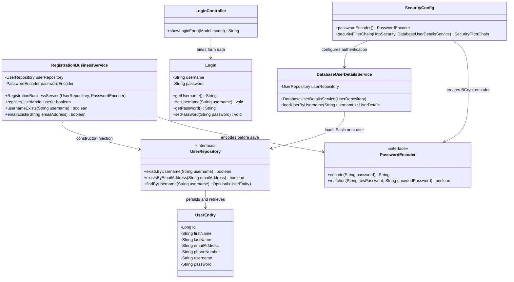

# Login and Registration Module — Class Diagram

This diagram documents the final database-backed authentication design. New passwords are encoded with BCrypt before persistence, and the same stored hash supports form login and HTTP Basic authentication for the service API.

## Relationship summary

- `LoginController` displays the custom login page; Spring Security processes submitted credentials and logout requests.
- `SecurityConfig` protects routes, configures form login and HTTP Basic authentication, enforces CSRF on browser requests, and creates the BCrypt encoder.
- `RegistrationBusinessService` checks uniqueness and stores only the BCrypt-encoded password.
- `DatabaseUserDetailsService` supplies the same account data for browser form login and HTTP Basic authentication on `/service/**`.
- `UserRepository` is a Spring Data JDBC `CrudRepository` backed by MySQL.
- `UserEntity.password` contains the BCrypt hash despite retaining the existing database column/property name.
- `Login` is the validated form model carrying the submitted username and password.

Existing rows created before BCrypt was enabled must have their passwords reset or be re-registered; plaintext fallback authentication is intentionally not supported.
