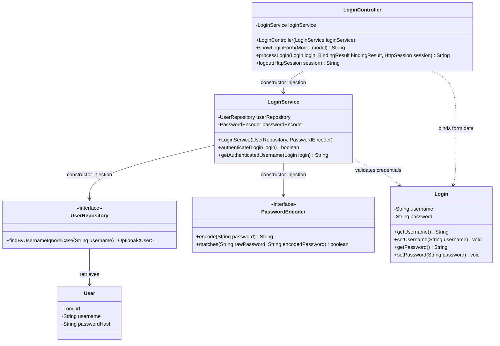

# Login Database Refactor — Class Diagram

This diagram documents the Login Module after authentication moved from hardcoded credentials to an injected database data layer.

## Relationship summary

- `LoginController` is the presentation-layer Spring `@Controller`. It receives `LoginService` through constructor injection and retains validation, session management, redirects, and logout handling.
- `LoginService` is the business-layer Spring `@Service` bean. It receives both the `UserRepository` and `PasswordEncoder` through constructor injection, so it contains no hardcoded credentials.
- `UserRepository` is the Spring Data JPA data-access layer that retrieves a persistent `User` by username.
- `User` stores a unique username and BCrypt password hash in the embedded H2 database. The application seeds the developer account at startup so the existing login flow remains demonstrable.
- `Login` is the validated form model carrying the submitted username and password.
