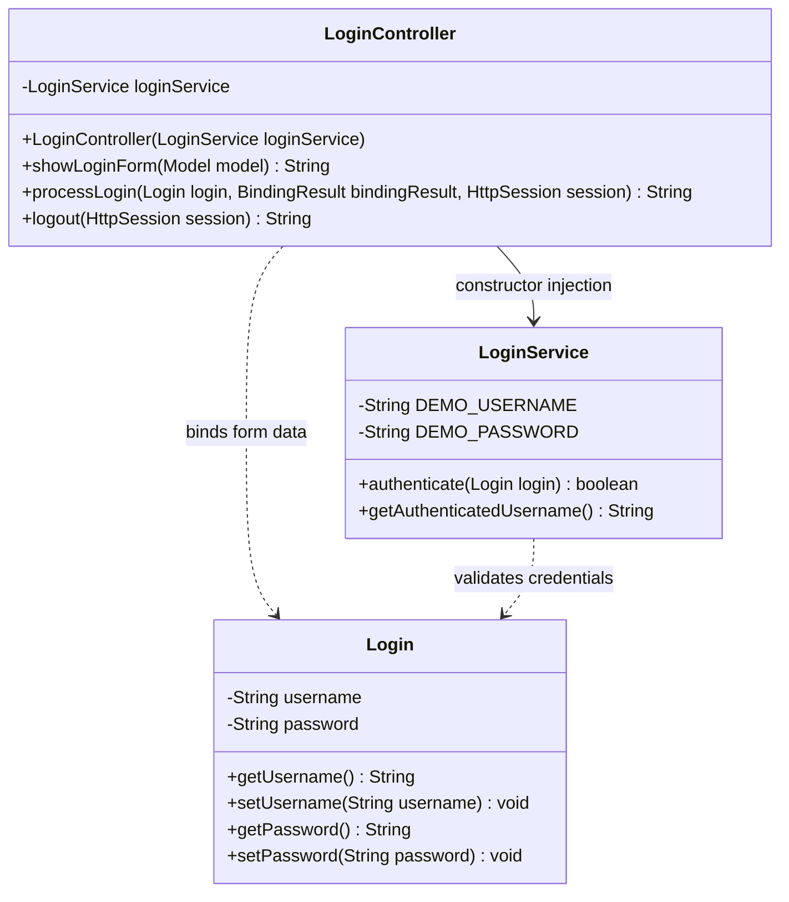

# Milestone 3 — Login Module Class Diagram

This diagram documents the Login Module after the Spring Beans, Spring Core, and dependency-injection refactor. Authentication remains simulated; no database is used in this milestone.

## Relationship summary

- `LoginController` is the presentation-layer Spring `@Controller`. It receives `LoginService` through constructor injection and retains validation, session management, redirects, and logout handling.
- `LoginService` is the business-layer Spring `@Service` bean. It contains only the simulated authentication business rule.
- `Login` is the validated form model carrying the submitted username and password.
